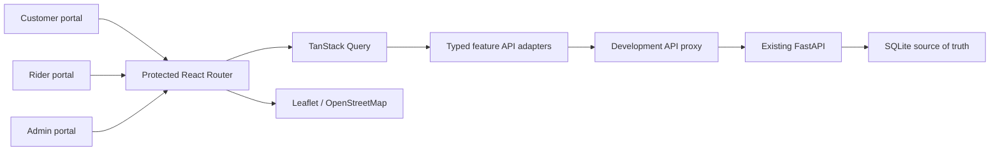

# Frontend architecture

`app` owns routing, auth/query/overlay providers and the error boundary.
`features/{auth,customer,rider,admin}` separates pages, reusable feature components,
hooks and API wrappers. Shared components own fields, buttons, badges, cards,
modal confirmations, toasts, skeletons, timelines, responsive tables and maps.
`lib/lifecycle.ts` centralizes actual status aliases, cancellation/transition rules,
UTC timestamp parsing, completion rate and request-to-delivery duration.

The rider API wrapper adapts the existing server envelope to pending deliveries.
The UI has no separate broadcast-offer model. There is no second backend,
automatic assignment, worker, WebSocket, or fake successful response. Requests and
availability poll through HTTP every five seconds. Query keys deduplicate shared
requests; hidden-tab intervals pause; terminal tracking stops polling.

Auth treats server tokens as opaque credentials. Role guards match the actual
logged-in user; the server remains authoritative for every permission and state
transition. Session restoration calls `/auth/me`. Token expiry clears the session.
Responses from an obsolete token cannot log out a newer active session.

Maps use OpenStreetMap tiles and real fixed demo coordinates. A marker update
occurs only when marker data changes, so countdown ticks do not reset popups/pans.
No GPS, navigation routing, geocoding, fee calculation or payment is requested.
Tiles fail independently from operational data with a visible fallback notice.

Production requires SPA history fallback and a same-origin API reverse proxy, or
an explicitly allowed cross-origin API. No hosting/deployment is configured by
this rebuild.
